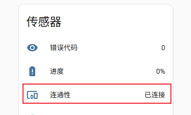
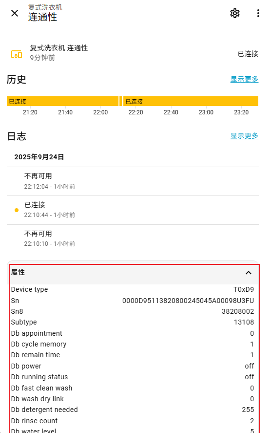

# Midea Auto Cloud

[English](README.md) | 简体中文

通过网络获取 MSmartHome/美的美居 家庭中的设备，并且通过美的云端API进行控制。

- 自动查找和发现设备
- 自动下载设备的协议文件
- 将设备状态更新为设备可见的属性

## 版本说明

- 所有设备默认可生成一个名为Status的二进制传感器，其属性中列出了设备可访问的所有属性，当然有些值不可设置
- Status实体前几项列出了该设备的分类信息，供参考

## 目前支持的设备类型

- T0x13 电灯
- T0x15 养生壶
- T0x17 智能晾衣架
- T0x21 中央空调网关
- T0x24 电压力锅
- T0x26 浴霸 
- T0x3D 电热水瓶
- T0x44 智能恒温器
- T0x5D 制冰机
- T0x9B 蒸烤箱
- T0x9C 集成灶
- T0xA1 除湿机
- T0xAC 空调
- T0xB0 微波炉
- T0xB2 电蒸箱
- T0xB3 消毒碗柜
- T0xB6 抽油烟机
- T0xB7 燃气灶
- T0xB8 智能扫地机器人
- T0xBC 空气检测仪
- T0xBF 微波炉
- T0xC1 壁挂炉
- T0xC2 智能马桶
- T0xC3 热泵
- T0xCA 对开门冰箱
- T0xCC 中央空调(风管机)Wi-Fi线控器
- T0xCD 空气能热水器
- T0xCE 新风机
- T0xCF 中央空调暖家
- T0xD9 复式洗衣机
- T0xDA 波轮洗衣机
- T0xDB 滚筒洗衣机
- T0xDC 干衣机
- T0xE1 洗碗机
- T0xE2 电热水器
- T0xE3 恒温式燃气热水器
- T0xE6 壁挂炉
- T0xE7 电磁炉
- T0xEA 电饭锅
- T0xED 软水机
- T0xFA 电风扇
- T0xFB 电暖器
- T0xFC 空气净化器
- T0xFD 加湿器

欢迎合作开发添加更多设备支持。

合作开发方法：添加本插件后，找到未能正确识别的设备，点击对应设备`传感器`分类下的`连通性`：

展开下面的`属性`卡片，把里面这些字段随issue提交。 着重关注Device type、Subtype这两个字段，这是后续获得设备控制对应lua文件的基础。

再进入Homeassistant的安装目录， 在`.storage/midea_auto_cloud/lua/`目录下找到设备对应的T_0000_`Device type`_`Subtype`_***.lua文件，以及`.storage/midea_auto_cloud/plugin/`目录下的`zip`文件，等待适配就可以了。

## 实体映射

映射文件位于`device_mapping`下, 每个大的品类一个映射文件，目前支持映射的实体类型如下:
- sensor
- binary_sensor
- switch
- select
- climate
- fan
- water_heater

示例配置`22012227`演示了如何将设备属性映射成以上各种HomeAssistant中的实体。

## GR6 Pro 微波控制

GR6 Pro（`T0xBF`、SN8 `700006DJ`、subtype `5`）支持微波时长
（5–1795 秒，步长 5 秒）、5 档火力，以及开始、暂停、继续、取消按钮。
先选择时长和火力，再按“开始微波”；仅修改参数不会开始烹饪。
参数仅在当前 Home Assistant 会话内暂存，重启后须重新设置。
暂不开放蒸、烤或菜谱模式。

开始和继续前会重新读取炉门、童锁、故障及工作状态；状态不可读或不满足条件时拒绝操作。
发送后检查设备响应和实际工作状态，不自动重发加热命令，也不自动解锁或开启远程控制。
若结果未确认，请先在本机检查，不要连续重试。这些检查不能代替设备自身保护或安全操作。

已在现场用中火、30 秒设定验证开始、暂停、继续及提前取消。
其他火力和开门拦截未单独做实机测试，仍依赖美的云连接。

在现有 Home Assistant Python 环境的仓库根目录执行
`PYTHONPATH=. python -m unittest discover -s tests -p test_gr6_pro.py -v`
可运行离线测试；可选设置 `GR6_LUA_PATH` 指向设备已下载的 Lua 文件，以验证真实编码。
仓库不包含厂商 Lua 或账号配置。

## 捐赠

如果认为项目有趣或对你有帮助，欢迎捐赠支持。捐赠金额将用于日常插件维护，方便为大家提供更好的服务！

## 致谢

感谢[midea-meiju-codec](https://github.com/MattedBroadSky/midea-meiju-codec)项目提供的先验知识。