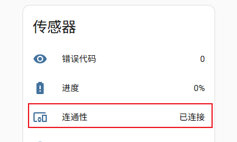
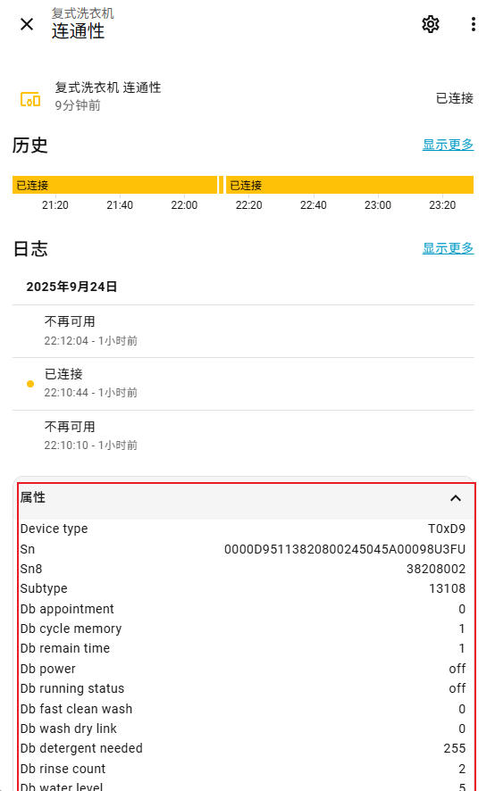

# Midea Auto Cloud

[](https://github.com/hacs/integration)
[](https://github.com/sususweet/midea-meiju-codec/releases/latest)

[English](README.md) | 简体中文

通过网络获取 MSmartHome/美的美居 家庭中的设备，并且通过美的云端API进行控制。

- 自动查找和发现设备
- 自动下载设备的协议文件
- 将设备状态更新为设备可见的属性

## 版本说明

- 所有设备默认可生成一个名为Status的二进制传感器，其属性中列出了设备可访问的所有属性，当然有些值不可设置
- Status实体前几项列出了该设备的分类信息，供参考

## 目前支持的设备类型

- T0x13 电灯
- T0x15 养生壶
- T0x17 智能晾衣架
- T0x21 中央空调网关
- T0x24 电压力锅
- T0x26 浴霸 
- T0x3D 电热水瓶
- T0x44 智能恒温器
- T0x5D 制冰机
- T0x9B 蒸烤箱
- T0x9C 集成灶
- T0xA1 除湿机
- T0xAC 空调
- T0xB0 微波炉
- T0xB2 电蒸箱
- T0xB3 消毒碗柜
- T0xB6 抽油烟机
- T0xB7 燃气灶
- T0xB8 智能扫地机器人
- T0xBC 空气检测仪
- T0xBF 微波炉
- T0xC1 壁挂炉
- T0xC2 智能马桶
- T0xC3 热泵
- T0xCA 对开门冰箱
- T0xCC 中央空调(风管机)Wi-Fi线控器
- T0xCD 空气能热水器
- T0xCE 新风机
- T0xCF 中央空调暖家
- T0xD9 复式洗衣机
- T0xDA 波轮洗衣机
- T0xDB 滚筒洗衣机
- T0xDC 干衣机
- T0xE1 洗碗机
- T0xE2 电热水器
- T0xE3 恒温式燃气热水器
- T0xE6 壁挂炉
- T0xE7 电磁炉
- T0xEA 电饭锅
- T0xED 软水机
- T0xFA 电风扇
- T0xFB 电暖器
- T0xFC 空气净化器
- T0xFD 加湿器

欢迎合作开发添加更多设备支持。

合作开发方法：添加本插件后，找到未能正确识别的设备，点击对应设备`传感器`分类下的`连通性`：



展开下面的`属性`卡片，把里面这些字段随issue提交。 着重关注Device type、Subtype这两个字段，这是后续获得设备控制对应lua文件的基础。

再进入Homeassistant的安装目录， 在`.storage/midea_auto_cloud/lua/`目录下找到设备对应的T_0000_`Device type`_`Subtype`_***.lua文件，以及`.storage/midea_auto_cloud/plugin/`目录下的`zip`文件，等待适配就可以了。



## 实体映射

映射文件位于`device_mapping`下, 每个大的品类一个映射文件，目前支持映射的实体类型如下:
- sensor
- binary_sensor
- switch
- select
- climate
- fan
- water_heater

示例配置`22012227`演示了如何将设备属性映射成以上各种HomeAssistant中的实体。

### 外部 Mapping 覆盖（按设备）

同一 `device_type` / `sn8` / `subtype` 的多台设备若需要不同实体映射（例如 Clivet 不同形态内机），可在集成 **配置 → 选项 → 设备 Mapping 覆盖** 中：

1. 选择设备（按名称 / 类型 / device_id）
2. **粘贴 JSON** 新建/更新 profile，或 **选用已有 profile**
3. 保存后自动重载该配置条目

数据保存在 `.storage/midea_auto_cloud/mappings/`（升级集成不会覆盖）：

```text
.storage/midea_auto_cloud/mappings/
  overrides.json          # device_id -> profile_id
  <profile_id>.json
```

Profile 示例（`mode: extend` 在内置 mapping 上合并；`replace` 整表替换）：

```json
{
  "profile": "clivet_cassette",
  "device_type": "T0xCC",
  "mode": "extend",
  "mapping": {
    "entities": {
      "climate": {
        "thermostat": {
          "fan_modes": { "1": {"wind_speed_level": "1"} }
        }
      }
    }
  }
}
```

`entities` 下平台键使用字符串（`climate` / `switch` 等）。overlay 中某键设为 `null` 可删除内置对应项。

自定义 profile 在你这边验证可用后，欢迎把可复用的片段整理进 `device_mapping/`（按 `device_type` / `sn8` / `subtype`）并发起 Pull Request，方便更多用户直接受益；外部 overlay 本身不保证与上游内置 mapping 长期一致。

## 捐赠

如果认为项目有趣或对你有帮助，欢迎捐赠支持。捐赠金额将用于日常插件维护，方便为大家提供更好的服务！


## 致谢

感谢[midea-meiju-codec](https://github.com/MattedBroadSky/midea-meiju-codec)项目提供的先验知识。